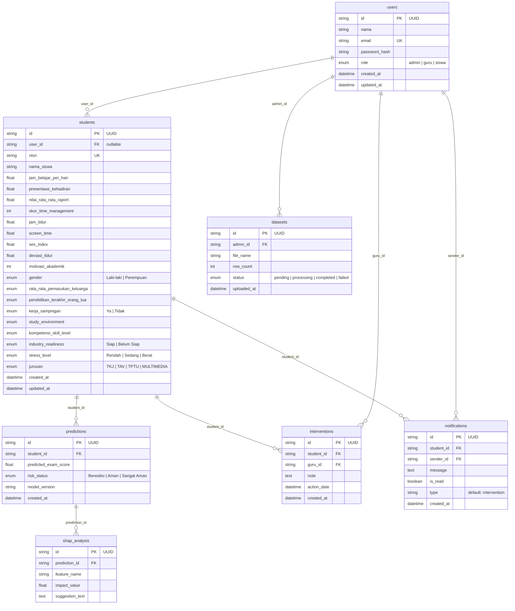
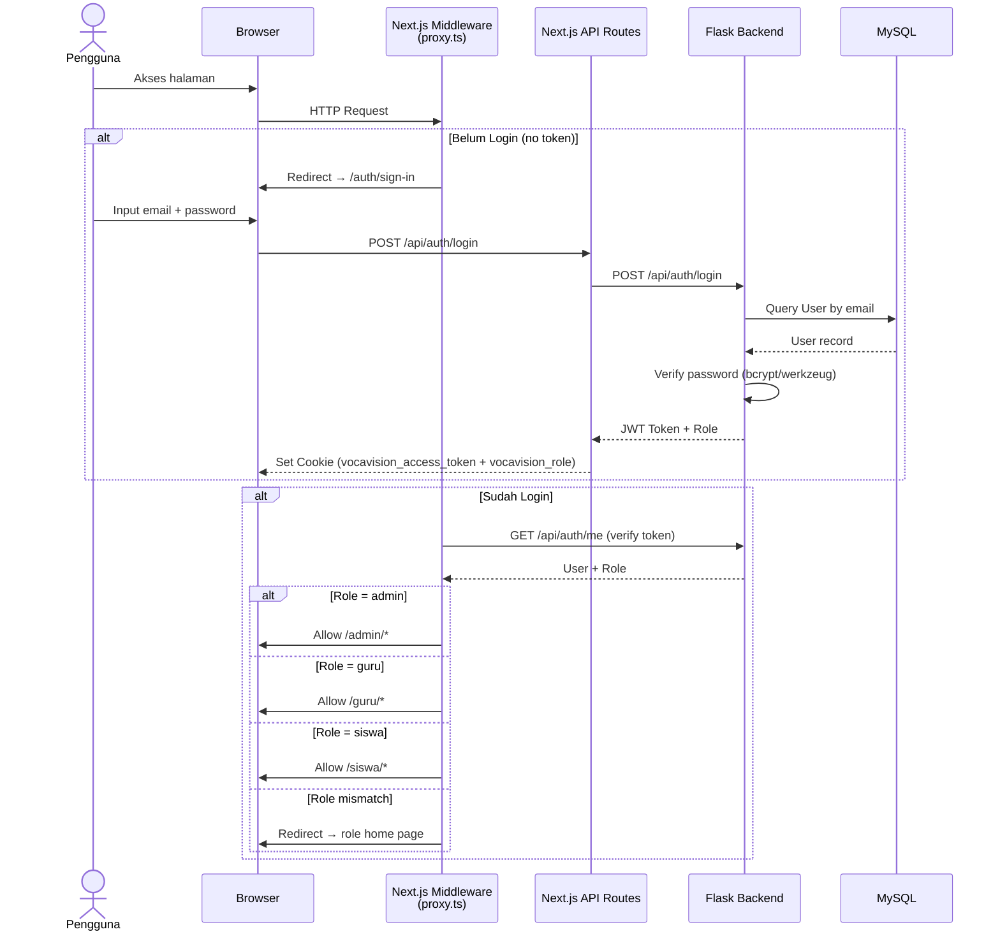
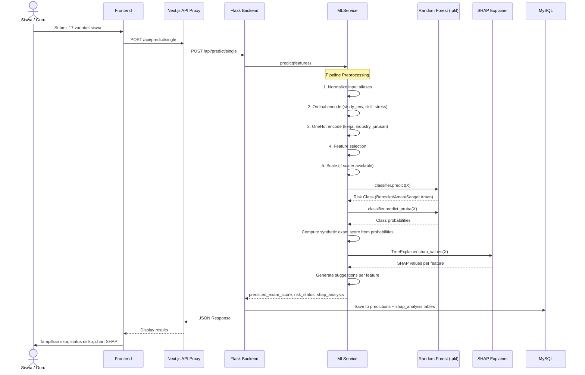
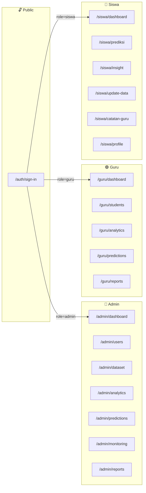
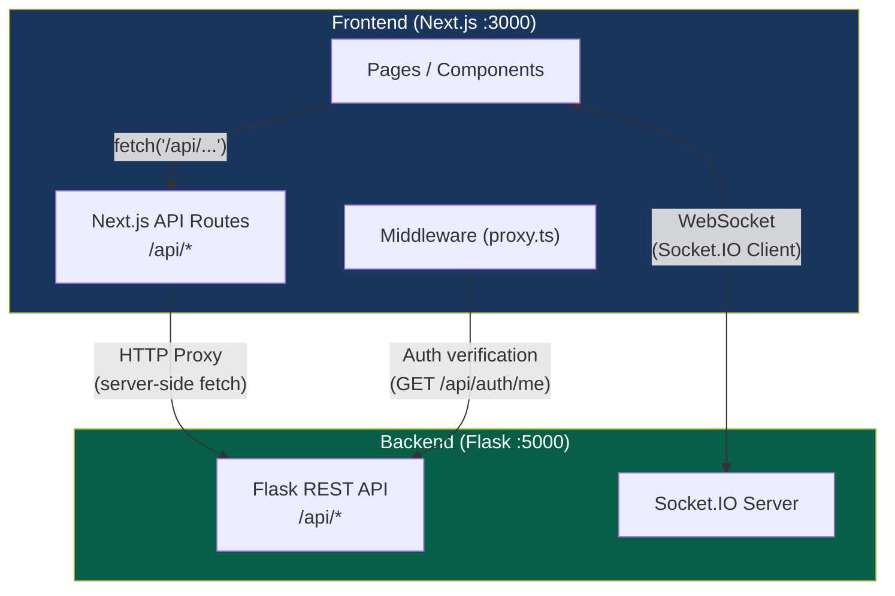
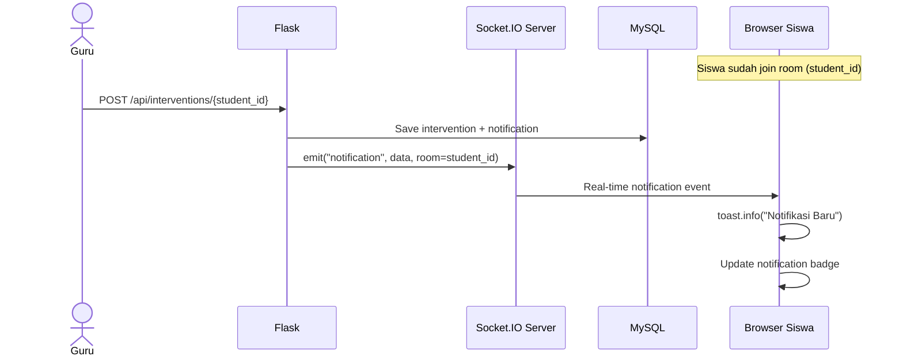
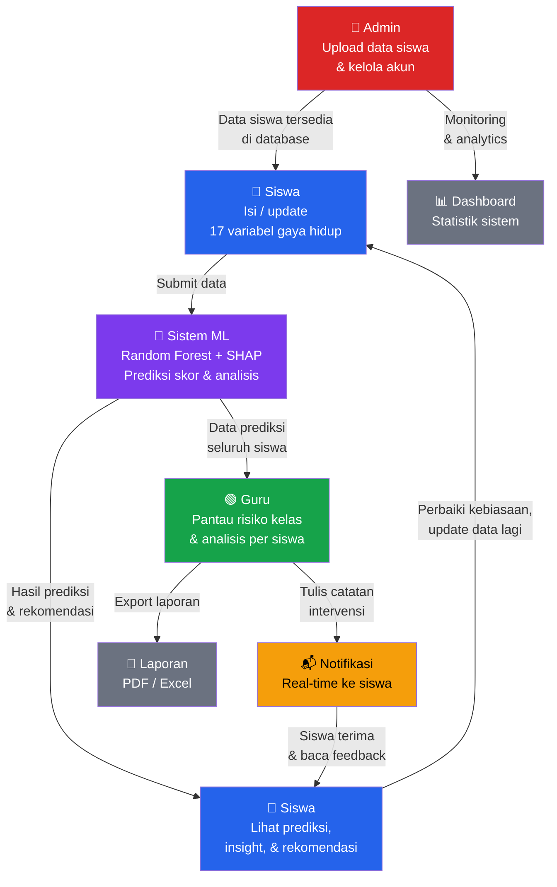
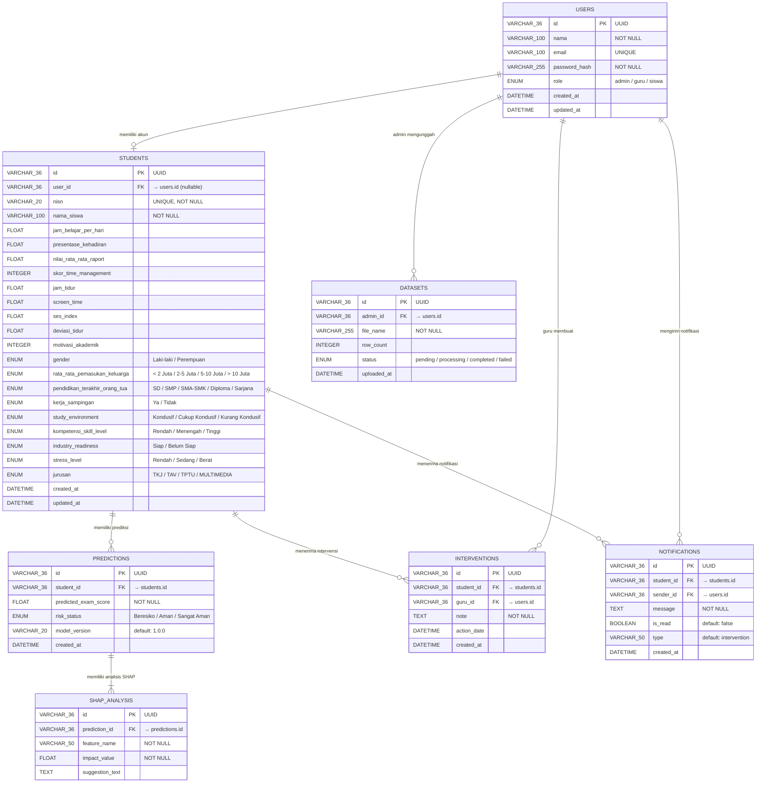
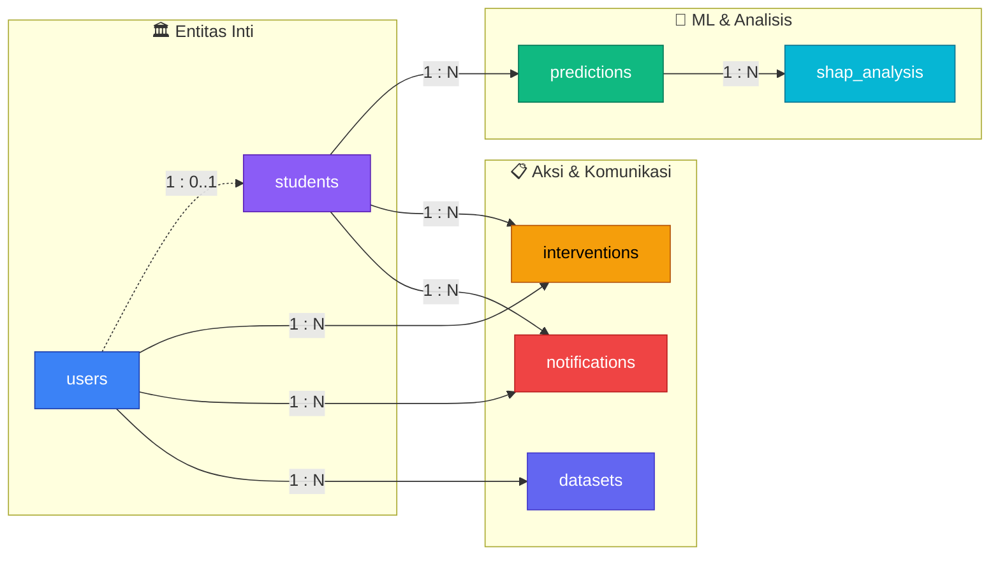

# 📊 Analisis Keseluruhan Project VOCAVISION

## 1. Ringkasan Project

**VOCAVISION** (Vocational Student Predictive Analytics) adalah platform analitik pendidikan berbasis web untuk memprediksi dan memantau performa akademik siswa SMK. Sistem menggunakan model **Random Forest** yang sudah dilatih sebelumnya dan **SHAP** untuk menjelaskan faktor-faktor yang mempengaruhi prediksi.

---

## 2. Arsitektur Sistem (Dual-Stack)

Proyek ini menggunakan arsitektur **dual-stack** dengan pemisahan jelas antara frontend dan backend:

```mermaid
graph TB
    subgraph CLIENT["🖥️ Browser Client"]
        BROWSER["React 19 UI<br/>(Next.js 16 App Router)"]
    end

    subgraph FRONTEND["⚡ Frontend Server (Port 3000)"]
        NEXTJS["Next.js 16<br/>App Router + Turbopack"]
        MIDDLEWARE["Middleware<br/>(proxy.ts)"]
        APIPROXY["Next.js API Routes<br/>(Proxy ke Backend)"]
        PRISMA["Prisma ORM<br/>(Auth Only)"]
    end

    subgraph BACKEND["🐍 Backend Server (Port 5000)"]
        FLASK["Flask App<br/>+ Flask-SocketIO"]
        JWT["Flask-JWT-Extended"]
        ROUTES["Blueprint Routes"]
        SERVICES["Services Layer"]
        ML["ML Service<br/>(Random Forest + SHAP)"]
    end

    subgraph DATABASE["🗄️ Database"]
        MYSQL["MySQL / MariaDB<br/>(SQLAlchemy)"]
        POSTGRES["PostgreSQL<br/>(Prisma - Auth)"]
    end

    subgraph ML_ARTIFACTS["🤖 ML Artifacts"]
        PKL_MODEL["model_rf_3class.pkl"]
        PKL_ENCODER["onehot_encoder.pkl<br/>ordinal_encoders.pkl"]
        PKL_PREP["preprocessing_info.pkl"]
        PKL_QUANT["target_quantiles.pkl"]
    end

    BROWSER -->|"HTTP Requests"| NEXTJS
    NEXTJS --> MIDDLEWARE
    MIDDLEWARE -->|"Auth Check"| JWT
    NEXTJS --> APIPROXY
    APIPROXY -->|"Proxy API calls"| FLASK
    BROWSER -->|"WebSocket (Socket.IO)"| FLASK
    FLASK --> ROUTES
    ROUTES --> SERVICES
    SERVICES --> ML
    ML --> PKL_MODEL
    ML --> PKL_ENCODER
    ML --> PKL_PREP
    ML --> PKL_QUANT
    FLASK --> MYSQL
    NEXTJS --> PRISMA
    PRISMA --> POSTGRES
```



---

## 3. Tech Stack Detail

### Frontend

| Teknologi | Versi | Fungsi |
|-----------|-------|--------|
| [Next.js](file:///d:/Pribadi/my%20project%20web/VOCAVISION/package.json) | 16 | Framework React dengan App Router |
| React | 19 | Library UI |
| TypeScript | 5 | Type Safety |
| Tailwind CSS | v4 (CSS-first) | Styling |
| Recharts | 2.12 | Charting / Visualisasi |
| Socket.IO Client | 4.8 | Real-time notifications |
| Sonner | 2.0 | Toast notifications |
| Zod | 4.3 | Schema validation |

### Backend

| Teknologi | Fungsi |
|-----------|--------|
| [Flask](file:///d:/Pribadi/my%20project%20web/VOCAVISION/backend/requirements.txt) | Web framework Python |
| Flask-SQLAlchemy | ORM untuk MySQL |
| Flask-JWT-Extended | Autentikasi JWT |
| Flask-SocketIO | Real-time WebSocket |
| Scikit-learn | Model Random Forest |
| SHAP | Explainability AI |
| Pandas / NumPy | Data processing |
| ReportLab | PDF export |
| OpenPyXL | Excel export |

### Database

| Database | Dikelola Oleh | Fungsi |
|----------|---------------|--------|
| MySQL / MariaDB | SQLAlchemy (Flask) | Data utama (students, predictions, dll) |
| PostgreSQL | Prisma (Next.js) | Auth schemas (User, Session, Account) |

---

## 4. Skema Database



---

## 5. Alur Autentikasi & Otorisasi



---

## 6. Alur Prediksi ML (Core Feature)



---

## 7. Struktur Halaman & Role-Based Access



---

## 8. Backend API Endpoints

### Flask Blueprint Routes ([**init**.py](file:///d:/Pribadi/my%20project%20web/VOCAVISION/backend/app/__init__.py))

| Blueprint | Prefix | File | Deskripsi |
|-----------|--------|------|-----------|
| `auth_bp` | `/api/auth` | [auth.py](file:///d:/Pribadi/my%20project%20web/VOCAVISION/backend/app/routes/auth.py) | Login, /me, update profile |
| `users_bp` | `/api/users` | [users.py](file:///d:/Pribadi/my%20project%20web/VOCAVISION/backend/app/routes/users.py) | CRUD pengguna |
| `predictions_bp` | `/api/predict` | [predictions.py](file:///d:/Pribadi/my%20project%20web/VOCAVISION/backend/app/routes/predictions.py) | Single/batch prediction |
| `students_bp` | `/api/students` | [students.py](file:///d:/Pribadi/my%20project%20web/VOCAVISION/backend/app/routes/students.py) | Data siswa |
| `interventions_bp` | `/api/interventions` | [interventions.py](file:///d:/Pribadi/my%20project%20web/VOCAVISION/backend/app/routes/interventions.py) | Catatan intervensi guru |
| `dashboard_bp` | `/api/dashboard` | [dashboard.py](file:///d:/Pribadi/my%20project%20web/VOCAVISION/backend/app/routes/dashboard.py) | Statistik dashboard |
| `dataset_bp` | `/api/dataset` | [dataset.py](file:///d:/Pribadi/my%20project%20web/VOCAVISION/backend/app/routes/dataset.py) | Upload & manage dataset |
| `export_bp` | `/api/export` | [export.py](file:///d:/Pribadi/my%20project%20web/VOCAVISION/backend/app/routes/export.py) | Export PDF/Excel |
| `notifications_bp` | `/api/notifications` | [notifications.py](file:///d:/Pribadi/my%20project%20web/VOCAVISION/backend/app/routes/notifications.py) | Notifikasi real-time |

---

## 9. Komunikasi Frontend ↔ Backend



> [!IMPORTANT]
> Frontend **TIDAK** langsung menghubungi Flask dari browser untuk REST API. Semua request di-proxy melalui **Next.js API Routes**. Hanya **Socket.IO** yang terhubung langsung dari browser ke Flask port 5000.

---

## 10. ML Pipeline Detail

### Model Artifacts ([ml_model/](file:///d:/Pribadi/my%20project%20web/VOCAVISION/backend/ml_model))

| File | Fungsi |
|------|--------|
| `model_rf_3class.pkl` | Random Forest Classifier (3 kelas) |
| `onehot_encoder.pkl` | OneHot encoder untuk fitur nominal |
| `ordinal_encoders.pkl` | Ordinal encoder untuk fitur ordinal |
| `preprocessing_info.pkl` | Metadata kolom & urutan fitur |
| `target_quantiles.pkl` | Threshold kelas (low: 82.90, high: 85.50) |

### Risk Classification

| Skor Prediksi | Status |
|--------------|--------|
| ≤ 82.57 | **Beresiko** 🔴 |
| 82.57 – 85.75 | **Aman** 🟡 |
| > 85.75 | **Sangat Aman** 🟢 |

### Input Features (17 Variabel)

**Numerik (8):**
`ses_index`, `jam_belajar_per_hari`, `screen_time`, `jam_tidur`, `deviasi_tidur`, `presentase_kehadiran`, `skor_time_management`, `motivasi_akademik`

**Ordinal (3):**
`study_environment`, `kompetensi_skill_level`, `stress_level`

**Nominal (3):**
`kerja_sampingan`, `industry_readiness`, `jurusan`

---

## 11. Real-time Notification System



---

## 12. Struktur Folder Project

```
VOCAVISION/
├── 📁 src/                          # Frontend Source
│   ├── 📁 app/                      # Next.js App Router
│   │   ├── 📁 (with-layout)/        # Pages dengan sidebar+navbar
│   │   │   ├── 📁 admin/            # 7 halaman admin
│   │   │   ├── 📁 guru/             # 5 halaman guru
│   │   │   └── 📁 siswa/            # 6 halaman siswa
│   │   ├── 📁 (without-layout)/     # Pages tanpa layout (auth)
│   │   ├── 📁 api/                  # Next.js API Routes (proxy)
│   │   └── layout.tsx               # Root layout
│   ├── 📁 components/               # React Components
│   │   ├── 📁 Auth/                 # Komponen autentikasi
│   │   ├── 📁 Charts/               # Visualisasi chart
│   │   ├── 📁 Layouts/              # Layout components
│   │   ├── 📁 Tables/               # Tabel data
│   │   ├── 📁 admin/                # Komponen admin
│   │   ├── 📁 guru/                 # Komponen guru
│   │   ├── 📁 ui/                   # UI primitives
│   │   └── socket-provider.tsx      # WebSocket context
│   ├── 📁 lib/                      # Utilities
│   │   ├── 📁 auth/                 # Auth helpers
│   │   └── utils.ts                 # Risk status, formatters
│   ├── 📁 services/                 # Data fetching
│   ├── 📁 hooks/                    # Custom React hooks
│   └── 📁 types/                    # TypeScript types
│
├── 📁 backend/                      # Backend Source (Python)
│   ├── 📁 app/
│   │   ├── __init__.py              # Flask app factory
│   │   ├── config.py                # DB & JWT config
│   │   ├── models.py                # SQLAlchemy models (7 tabel)
│   │   ├── 📁 routes/               # 9 Blueprint routes
│   │   └── 📁 services/
│   │       └── ml_service.py        # ML pipeline (640 lines)
│   ├── 📁 ml_model/                 # Model artifacts (.pkl)
│   └── run.py                       # Entry point
│
├── 📁 prisma/
│   └── schema.prisma                # Auth-only schema (PostgreSQL)
│
└── package.json                     # Node.js dependencies
```

---

## 13. Observasi & Catatan Penting

> [!NOTE]
> Project ini menggunakan **dual database**: MySQL (via SQLAlchemy) untuk semua data bisnis, dan PostgreSQL (via Prisma) hanya untuk auth schemas. Prisma schema bahkan memiliki warning untuk TIDAK menambahkan tabel bisnis di sana.

> [!WARNING]
> Ada inkonsistensi penamaan risk status antara dokumentasi CLAUDE.md (`Beresiko / Beresiko / Tidak Beresiko`) dan implementasi aktual di code (`Beresiko / Aman / Sangat Aman`). Implementasi yang aktif adalah **Beresiko / Aman / Sangat Aman**.

> [!TIP]
> ML Model sudah mature — menggunakan preprocessing pipeline lengkap (ordinal + onehot + feature selection + scaling) dengan fallback dummy model untuk development tanpa file .pkl. SHAP explainability terintegrasi langsung dalam prediksi.

# 🔄 Alur Sistem VOCAVISION – Gambaran Umum

## Konsep Utama

VOCAVISION adalah sistem **deteksi dini risiko akademik** siswa SMK. Sistem memprediksi apakah seorang siswa berisiko gagal dalam ujian berdasarkan 17 faktor gaya hidup & kebiasaan belajar, lalu memberikan rekomendasi perbaikan.

---

## Peran & Alur Kerja per Role

### 🔴 Admin – "Pengelola Sistem"

Admin bertugas **menyiapkan dan mengelola fondasi data** agar sistem bisa berjalan.

```
Admin login → Kelola akun pengguna (guru & siswa)
            → Upload dataset siswa (CSV/Excel)
            → Pantau statistik sistem keseluruhan
            → Lihat analytics / EDA data
            → Export laporan
```

**Apa yang bisa dilakukan Admin:**

- **Mengelola akun** – Menambah, mengedit, dan menghapus akun guru & siswa
- **Upload dataset massal** – Upload file CSV/Excel berisi data banyak siswa sekaligus, sistem akan memproses dan menyimpan ke database
- **Monitoring** – Melihat ringkasan seluruh sistem (total siswa, distribusi risiko, tren)
- **Analytics** – Melihat visualisasi Exploratory Data Analysis (EDA)
- **Export** – Mengunduh laporan dalam format PDF/Excel

---

### 🟢 Guru – "Pemantau & Pemberi Intervensi"

Guru bertugas **memantau kondisi siswa, memahami penyebab risiko, dan memberikan tindakan intervensi**.

```
Guru login → Lihat dashboard kelas (ringkasan risiko)
           → Lihat daftar seluruh siswa + status risiko
           → Klik siswa tertentu
              → Lihat detail 17 variabel siswa
              → Lihat prediksi skor & status risiko
              → Lihat grafik SHAP (faktor penyebab)
              → Tulis catatan intervensi / tindak lanjut
           → Export laporan prediksi (PDF/Excel)
```

**Apa yang bisa dilakukan Guru:**

- **Dashboard kelas** – Melihat jumlah siswa berisiko, rata-rata skor prediksi, distribusi risiko
- **Daftar siswa** – Mencari & memfilter siswa berdasarkan nama, risiko, jurusan
- **Detail siswa** – Melihat profil lengkap 17 variabel + riwayat prediksi
- **Analisis SHAP** – Memahami *mengapa* siswa diprediksi berisiko (faktor apa yang paling berpengaruh)
- **Intervensi** – Menulis catatan tindak lanjut untuk siswa berisiko (misal: "Perlu bimbingan tambahan jam belajar"). Catatan ini akan dikirim sebagai **notifikasi real-time** ke siswa
- **Export** – Mengunduh laporan prediksi kelas

---

### 🔵 Siswa – "Self-Assessment & Penerima Feedback"

Siswa bertugas **mengisi data diri, melihat prediksi akademik, memahami rekomendasi, dan menerima feedback dari guru**.

```
Siswa login → Lihat dashboard pribadi (skor prediksi + status risiko)
            → Isi / update data 17 variabel gaya hidup
            → Jalankan prediksi baru
            → Lihat insight SHAP (penjelasan faktor penyebab)
            → Lihat rekomendasi perbaikan
            → Terima notifikasi real-time dari guru
            → Baca catatan intervensi guru
```

**Apa yang bisa dilakukan Siswa:**

- **Dashboard** – Melihat skor prediksi ujian dan status risiko (Beresiko / Aman / Sangat Aman)
- **Update data** – Mengisi kuesioner 17 variabel (jam belajar, kehadiran, jam tidur, screen time, stres, dll.)
- **Prediksi** – Setelah mengisi data, sistem langsung memprediksi skor dan status risiko
- **Insight** – Melihat penjelasan SHAP: faktor mana yang paling menurunkan/meningkatkan skor, beserta rekomendasi konkret (misal: "Jam tidur menurunkan skor secara signifikan. Disarankan menjaga tidur 7-8 jam per malam")
- **Catatan guru** – Membaca catatan intervensi yang ditulis guru
- **Notifikasi** – Menerima pemberitahuan real-time saat guru menulis catatan baru

---

## Siklus Penggunaan Sistem



---

## Ringkasan Singkat

| Role | Tugas Utama | Berinteraksi Dengan |
|------|-------------|---------------------|
| **Admin** | Kelola akun, upload dataset, monitoring sistem | Database, akun guru & siswa |
| **Guru** | Pantau risiko siswa, analisis SHAP, beri intervensi, export laporan | Data prediksi siswa, sistem notifikasi |
| **Siswa** | Isi data gaya hidup, lihat prediksi & rekomendasi, terima feedback guru | Form input, hasil ML, catatan guru |

> **Intinya:** Admin menyiapkan data → Siswa mengisi variabel → Sistem memprediksi → Guru menganalisis & memberi intervensi → Siswa menerima feedback & memperbaiki kebiasaan → Siklus berulang.

---

# 4.6. Perancangan Basis Data

## 4.4.1. Entity Relationship Diagram (ERD)

Diagram berikut menggambarkan entitas-entitas utama dalam sistem VOCAVISION beserta atribut dan relasi antar entitas menggunakan notasi ERD.



---

## 4.4.2. Struktur Tabel

Berikut adalah struktur detail dari setiap tabel dalam basis data VOCAVISION:

### Tabel 1: `users`

Menyimpan data akun seluruh pengguna sistem (admin, guru, dan siswa).

| No | Nama Kolom | Tipe Data | Constraint | Keterangan |
|----|-----------|-----------|------------|------------|
| 1 | `id` | VARCHAR(36) | PRIMARY KEY | UUID, auto-generate |
| 2 | `nama` | VARCHAR(100) | NOT NULL | Nama lengkap pengguna |
| 3 | `email` | VARCHAR(100) | UNIQUE, NULLABLE | Alamat email pengguna |
| 4 | `password_hash` | VARCHAR(255) | NOT NULL | Hash password (bcrypt) |
| 5 | `role` | ENUM('admin','guru','siswa') | NOT NULL | Peran pengguna dalam sistem |
| 6 | `created_at` | DATETIME | DEFAULT NOW | Waktu pembuatan akun |
| 7 | `updated_at` | DATETIME | DEFAULT NOW, ON UPDATE | Waktu terakhir diperbarui |

---

### Tabel 2: `students`

Menyimpan data profil dan variabel gaya hidup siswa yang digunakan sebagai fitur input untuk model prediksi ML.

| No | Nama Kolom | Tipe Data | Constraint | Keterangan |
|----|-----------|-----------|------------|------------|
| 1 | `id` | VARCHAR(36) | PRIMARY KEY | UUID, auto-generate |
| 2 | `user_id` | VARCHAR(36) | FOREIGN KEY → `users.id`, NULLABLE | Relasi ke akun user (opsional) |
| 3 | `nisn` | VARCHAR(20) | UNIQUE, NOT NULL | Nomor Induk Siswa Nasional |
| 4 | `nama_siswa` | VARCHAR(100) | NOT NULL | Nama lengkap siswa |
| 5 | `jam_belajar_per_hari` | FLOAT | NULLABLE | Rata-rata jam belajar per hari |
| 6 | `presentase_kehadiran` | FLOAT | NULLABLE | Persentase kehadiran (0–100) |
| 7 | `nilai_rata_rata_raport` | FLOAT | NULLABLE | Nilai rata-rata raport terakhir |
| 8 | `skor_time_management` | INTEGER | NULLABLE | Skor kemampuan manajemen waktu |
| 9 | `jam_tidur` | FLOAT | NULLABLE | Rata-rata jam tidur per hari |
| 10 | `screen_time` | FLOAT | NULLABLE | Rata-rata screen time per hari (jam) |
| 11 | `ses_index` | FLOAT | NULLABLE | Indeks sosial ekonomi |
| 12 | `deviasi_tidur` | FLOAT | NULLABLE | Deviasi/variasi jam tidur |
| 13 | `motivasi_akademik` | INTEGER | NULLABLE | Skor motivasi akademik |
| 14 | `gender` | ENUM('Laki-laki','Perempuan') | NULLABLE | Jenis kelamin |
| 15 | `rata_rata_pemasukan_keluarga` | ENUM('< 2 Juta','2 - 5 Juta','5 - 10 Juta','> 10 Juta') | NULLABLE | Kategori pemasukan keluarga |
| 16 | `pendidikan_terakhir_orang_tua` | ENUM('SD','SMP','SMA/SMK','Diploma','Sarjana') | NULLABLE | Pendidikan terakhir orang tua |
| 17 | `kerja_sampingan` | ENUM('Ya','Tidak') | NULLABLE | Apakah siswa bekerja sampingan |
| 18 | `study_environment` | ENUM('Kondusif','Cukup Kondusif','Kurang Kondusif') | NULLABLE | Kondisi lingkungan belajar |
| 19 | `kompetensi_skill_level` | ENUM('Rendah','Menengah','Tinggi') | NULLABLE | Tingkat kompetensi skill |
| 20 | `industry_readiness` | ENUM('Siap','Belum Siap') | NULLABLE | Kesiapan industri |
| 21 | `stress_level` | ENUM('Rendah','Sedang','Berat') | NULLABLE | Tingkat stres siswa |
| 22 | `jurusan` | ENUM('TKJ','TAV','TPTU','MULTIMEDIA') | NULLABLE | Jurusan siswa di SMK |
| 23 | `created_at` | DATETIME | DEFAULT NOW | Waktu data dibuat |
| 24 | `updated_at` | DATETIME | DEFAULT NOW, ON UPDATE | Waktu terakhir diperbarui |

> [!NOTE]
> Kolom nomor 5–22 merupakan **17 fitur input** yang digunakan oleh model Random Forest untuk prediksi risiko akademik. Fitur dibagi menjadi 2 kategori: **9 fitur numerik** (no. 5–13) dan **9 fitur kategorikal** (no. 14–22).

---

### Tabel 3: `predictions`

Menyimpan hasil prediksi model ML untuk setiap siswa.

| No | Nama Kolom | Tipe Data | Constraint | Keterangan |
|----|-----------|-----------|------------|------------|
| 1 | `id` | VARCHAR(36) | PRIMARY KEY | UUID, auto-generate |
| 2 | `student_id` | VARCHAR(36) | FOREIGN KEY → `students.id`, NOT NULL | Relasi ke siswa yang diprediksi |
| 3 | `predicted_exam_score` | FLOAT | NOT NULL | Skor ujian yang diprediksi |
| 4 | `risk_status` | ENUM('Beresiko','Aman','Sangat Aman') | NOT NULL | Status risiko akademik (3 kelas) |
| 5 | `model_version` | VARCHAR(20) | DEFAULT '1.0.0' | Versi model ML yang digunakan |
| 6 | `created_at` | DATETIME | DEFAULT NOW | Waktu prediksi dilakukan |

---

### Tabel 4: `shap_analysis`

Menyimpan hasil analisis SHAP (SHapley Additive exPlanations) untuk setiap prediksi, menjelaskan kontribusi masing-masing fitur.

| No | Nama Kolom | Tipe Data | Constraint | Keterangan |
|----|-----------|-----------|------------|------------|
| 1 | `id` | VARCHAR(36) | PRIMARY KEY | UUID, auto-generate |
| 2 | `prediction_id` | VARCHAR(36) | FOREIGN KEY → `predictions.id`, NOT NULL | Relasi ke prediksi terkait |
| 3 | `feature_name` | VARCHAR(50) | NOT NULL | Nama fitur (misal: `jam_belajar_per_hari`) |
| 4 | `impact_value` | FLOAT | NOT NULL | Nilai dampak SHAP (positif = meningkatkan skor, negatif = menurunkan) |
| 5 | `suggestion_text` | TEXT | NULLABLE | Teks saran perbaikan berdasarkan fitur |

---

### Tabel 5: `interventions`

Menyimpan catatan intervensi yang diberikan guru kepada siswa berisiko.

| No | Nama Kolom | Tipe Data | Constraint | Keterangan |
|----|-----------|-----------|------------|------------|
| 1 | `id` | VARCHAR(36) | PRIMARY KEY | UUID, auto-generate |
| 2 | `student_id` | VARCHAR(36) | FOREIGN KEY → `students.id`, NOT NULL | Siswa yang menerima intervensi |
| 3 | `guru_id` | VARCHAR(36) | FOREIGN KEY → `users.id`, NOT NULL | Guru yang memberikan intervensi |
| 4 | `note` | TEXT | NOT NULL | Catatan/isi intervensi |
| 5 | `action_date` | DATETIME | DEFAULT NOW | Tanggal intervensi dilaksanakan |
| 6 | `created_at` | DATETIME | DEFAULT NOW | Waktu record dibuat |

---

### Tabel 6: `datasets`

Menyimpan metadata file dataset yang diunggah oleh admin.

| No | Nama Kolom | Tipe Data | Constraint | Keterangan |
|----|-----------|-----------|------------|------------|
| 1 | `id` | VARCHAR(36) | PRIMARY KEY | UUID, auto-generate |
| 2 | `admin_id` | VARCHAR(36) | FOREIGN KEY → `users.id`, NOT NULL | Admin yang mengunggah file |
| 3 | `file_name` | VARCHAR(255) | NOT NULL | Nama file yang diunggah |
| 4 | `row_count` | INTEGER | NULLABLE | Jumlah baris data dalam file |
| 5 | `status` | ENUM('pending','processing','completed','failed') | DEFAULT 'pending' | Status proses upload |
| 6 | `uploaded_at` | DATETIME | DEFAULT NOW | Waktu file diunggah |

---

### Tabel 7: `notifications`

Menyimpan notifikasi yang dikirimkan ke siswa (misalnya setelah guru memberi intervensi).

| No | Nama Kolom | Tipe Data | Constraint | Keterangan |
|----|-----------|-----------|------------|------------|
| 1 | `id` | VARCHAR(36) | PRIMARY KEY | UUID, auto-generate |
| 2 | `student_id` | VARCHAR(36) | FOREIGN KEY → `students.id`, NOT NULL | Siswa penerima notifikasi |
| 3 | `sender_id` | VARCHAR(36) | FOREIGN KEY → `users.id`, NOT NULL | Pengirim notifikasi (guru/admin) |
| 4 | `message` | TEXT | NOT NULL | Isi pesan notifikasi |
| 5 | `is_read` | BOOLEAN | DEFAULT FALSE | Status baca notifikasi |
| 6 | `type` | VARCHAR(50) | DEFAULT 'intervention' | Jenis notifikasi |
| 7 | `created_at` | DATETIME | DEFAULT NOW | Waktu notifikasi dibuat |

---

## 4.4.3. Relasi Antar Tabel

Berikut adalah penjelasan detail mengenai relasi antar tabel dalam basis data VOCAVISION:



### Daftar Relasi

| No | Tabel Induk | Tabel Anak | Kunci Relasi | Kardinalitas | Keterangan |
|----|-------------|-----------|--------------|--------------|------------|
| 1 | `users` | `students` | `students.user_id` → `users.id` | **1 : 0..1** | Satu user dengan role 'siswa' dapat memiliki maksimal satu profil student. Relasi bersifat opsional (nullable) karena data siswa bisa diupload oleh admin tanpa akun user. |
| 2 | `students` | `predictions` | `predictions.student_id` → `students.id` | **1 : N** | Satu siswa dapat memiliki banyak prediksi (prediksi ulang setiap ada perubahan data). |
| 3 | `predictions` | `shap_analysis` | `shap_analysis.prediction_id` → `predictions.id` | **1 : N** | Satu prediksi menghasilkan banyak record SHAP (satu per fitur, maksimal 17 record). |
| 4 | `students` | `interventions` | `interventions.student_id` → `students.id` | **1 : N** | Satu siswa dapat menerima banyak catatan intervensi dari waktu ke waktu. |
| 5 | `users` | `interventions` | `interventions.guru_id` → `users.id` | **1 : N** | Satu guru dapat membuat banyak intervensi untuk berbagai siswa. |
| 6 | `users` | `datasets` | `datasets.admin_id` → `users.id` | **1 : N** | Satu admin dapat mengunggah banyak file dataset. |
| 7 | `students` | `notifications` | `notifications.student_id` → `students.id` | **1 : N** | Satu siswa dapat menerima banyak notifikasi. |
| 8 | `users` | `notifications` | `notifications.sender_id` → `users.id` | **1 : N** | Satu user (guru/admin) dapat mengirim banyak notifikasi. |

### Penjelasan Alur Relasi

1. **Users → Students** (Opsional): Tabel `users` menyimpan data autentikasi, sedangkan `students` menyimpan data profil dan variabel gaya hidup. Tidak semua student harus memiliki akun user — data bisa diimpor melalui upload dataset oleh admin.

2. **Students → Predictions → SHAP Analysis** (Chain): Alur utama ML dimulai dari data student → menghasilkan prediksi → setiap prediksi dianalisis SHAP-nya. Ini membentuk **rantai relasi** satu arah dari data mentah ke hasil analisis.

3. **Users (Guru) → Interventions ← Students**: Tabel `interventions` merupakan **tabel asosiatif** yang menghubungkan guru dengan siswa melalui catatan intervensi. Ini memungkinkan pelacakan siapa memberikan intervensi kepada siapa dan kapan.

4. **Users → Notifications ← Students**: Serupa dengan interventions, tabel `notifications` menghubungkan pengirim (guru/admin) dengan penerima (siswa), memfasilitasi komunikasi satu arah dalam sistem.

5. **Users (Admin) → Datasets**: Tabel `datasets` mencatat metadata upload, memungkinkan audit trail siapa yang mengunggah data kapan dan berapa banyak record yang diproses.

> [!IMPORTANT]
> Seluruh tabel menggunakan **UUID (VARCHAR 36)** sebagai primary key untuk keamanan dan skalabilitas. Tidak ada penggunaan auto-increment integer ID yang dapat ditebak polanya.

> [!NOTE]
> Basis data utama menggunakan **MySQL/MariaDB** melalui SQLAlchemy ORM. Terdapat juga database terpisah **PostgreSQL** melalui Prisma yang digunakan khusus untuk authentication schema (NextAuth), namun tidak termasuk dalam ERD ini karena bukan bagian dari domain bisnis utama.
